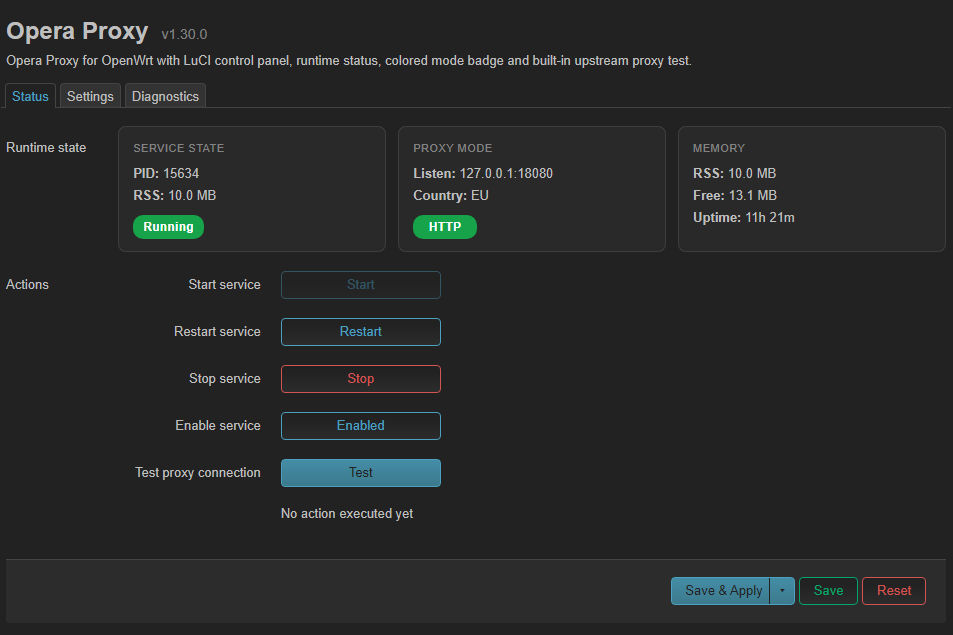
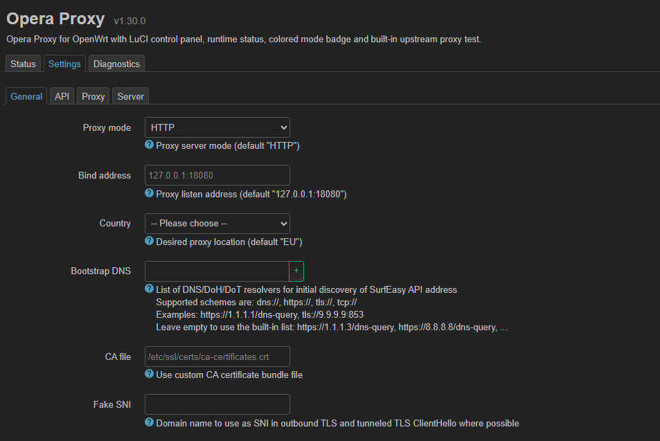
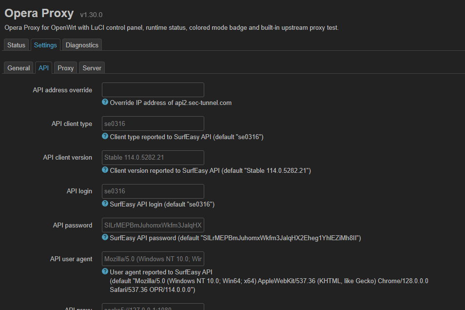
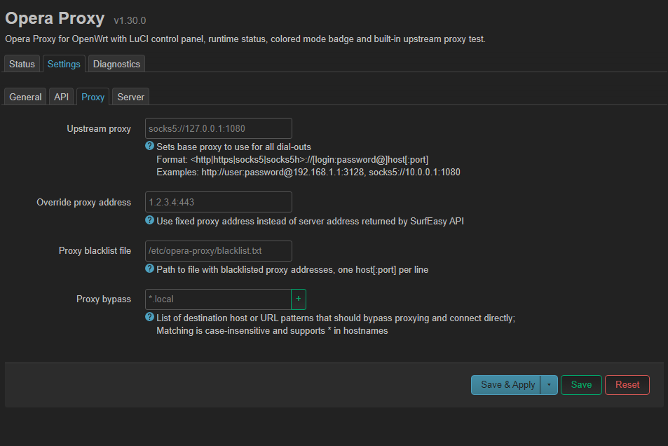
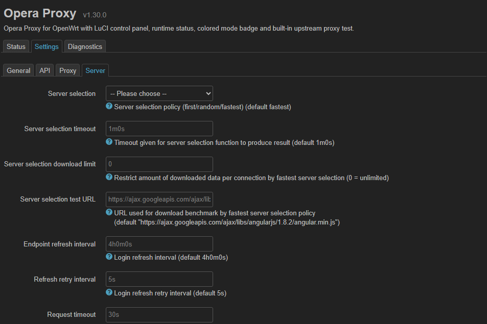
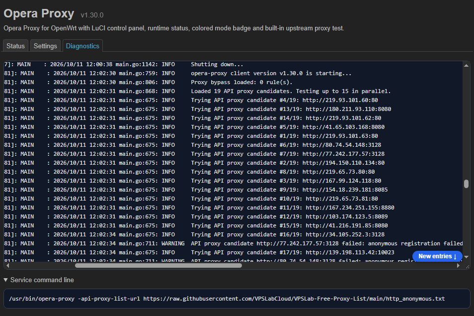

> Этот репозиторий содержит сочетание кода, созданного владельцем репозитория, и кода, сгенерированного с помощью инструментов искусственного интеллекта.

# openwrt-opera-proxy

Пакеты для OpenWrt: [opera-proxy](https://github.com/Alexey71/opera-proxy) (локальный HTTP/SOCKS5-прокси через Opera VPN),
веб-интерфейс LuCI и русская локализация. Всё собирается автоматически в GitHub Actions.

| Пакет | Содержимое | Архитектура |
|---|---|---|
| `opera-proxy` | бинарник, init-скрипт, `/etc/config/opera-proxy` | своя для каждой архитектуры |
| `luci-app-opera-proxy` | LuCI: состояние и управление, настройки, диагностика | `all` |
| `luci-i18n-opera-proxy-ru` | русский перевод интерфейса | `all` |

Форматы: **`.ipk`** — OpenWrt 24.10 (opkg), **`.apk`** — OpenWrt 25.12 (apk).
Архитектуры по умолчанию: `mipsel_24kc`, `mips_24kc`, `arm_cortex-a7_neon-vfpv4`, `aarch64_cortex-a53`, `x86_64`.

## Скриншоты

| Состояние и управление | Настройки: General |
|---|---|
|  |  |

| Настройки: API | Настройки: Proxy |
|---|---|
|  |  |

| Настройки: Server | Диагностика |
|---|---|
|  |  |

## Установка

### Быстрая установка скриптом

Скрипт сам определяет менеджер пакетов (`opkg` → `.ipk`, `apk` → `.apk`) и архитектуру, скачивает
нужные файлы из последнего релиза и устанавливает бинарник, веб-интерфейс LuCI и русский перевод.
Выполните на роутере (по SSH):

    uclient-fetch -q -O - https://raw.githubusercontent.com/PaWill68/openwrt-opera-proxy/master/scripts/install.sh | sh

Если `uclient-fetch` недоступен: `wget -q -O - <тот же адрес> | sh` или `curl -fsSL <тот же адрес> | sh`.

Параметры передаются переменными окружения перед `sh`:

| Переменная | Значение по умолчанию | Что делает |
|---|---|---|
| `TAG` | `latest` | конкретный релиз, например `TAG=v1.30.0-1` |
| `LANGS` | `ru` | языки перевода через пробел; `LANGS=""` — без перевода |
| `WITH_LUCI` | `1` | `WITH_LUCI=0` — только бинарник и сервис, без веб-интерфейса |
| `REPO` | `PaWill68/openwrt-opera-proxy` | откуда брать релизы |
| `PKG_ARCH` | определяется сам | принудительно указать архитектуру пакетов, например `PKG_ARCH=aarch64_cortex-a53` |

Пример: `uclient-fetch -q -O - <адрес> | WITH_LUCI=0 sh`.
Архитектура пакетов определяется так (берётся первая, для которой в релизе есть пакет): заданная вручную `PKG_ARCH`;
`DISTRIB_ARCH` из `/etc/openwrt_release` (именно под неё собраны пакеты прошивки); затем то, что сообщает менеджер пакетов
(для `opkg` — все архитектуры из `opkg print-architecture` от самой приоритетной, кроме `all` и `noarch`; для `apk` —
`apk --print-arch`). Если подходящего пакета нет, скрипт перечислит, для каких архитектур он есть. После установки скрипт
запускает `opera-proxy -version`: менеджер пакетов проверяет только имя архитектуры, а не то, что процессор умеет выполнять
бинарник, и при несовпадении вы увидите предупреждение вместо молчаливо нерабочей установки.

Вывод терминала при удачной установке:

    root@router:~# uclient-fetch -q -O - https://raw.githubusercontent.com/PaWill68/openwrt-opera-proxy/master/scripts/install.sh | sh
    Менеджер пакетов: opkg (.ipk), архитектура пакетов: aarch64_cortex-a53
    Загрузка: opera-proxy_1.30.0-r1_aarch64_cortex-a53.ipk
    Загрузка: luci-app-opera-proxy_1.30.0-r1_all.ipk
    Загрузка: luci-i18n-opera-proxy-ru_1.30.0-r1_all.ipk
    Установка (opkg)...
    Installing opera-proxy (1.30.0-r1) to root...
    Installing luci-app-opera-proxy (1.30.0-r1) to root...
    Installing luci-i18n-opera-proxy-ru (1.30.0-r1) to root...
    Configuring opera-proxy.
    Configuring luci-app-opera-proxy.
    Configuring luci-i18n-opera-proxy-ru.
    
    Готово: opera-proxy v1.30.0 (aarch64_cortex-a53) установлен.
    Веб-интерфейс: LuCI -> Службы -> Opera Proxy (при необходимости обновите страницу через Ctrl+F5).
    Статус службы: /etc/init.d/opera-proxy status
    root@router:~# 

### Ручная установка

Готовые пакеты — на странице [Releases](../../releases). Нужную архитектуру роутера/пакетов покажет:

    opkg print-architecture        # OpenWrt 24.10 (берите самую приоритетную строку, не all)
    apk --print-arch               # OpenWrt 25.12
    . /etc/openwrt_release; echo "$DISTRIB_ARCH"  # если присутствует в прошивке

OpenWrt 24.10:

    opkg update
    opkg install /tmp/opera-proxy_*_<АРХИТЕКТУРА>.ipk \
        /tmp/luci-app-opera-proxy_*_all.ipk \
        /tmp/luci-i18n-opera-proxy-ru_*_all.ipk

OpenWrt 25.12 (пакеты не подписаны ключом репозитория):

    apk update
    apk add --allow-untrusted /tmp/opera-proxy-*_<АРХИТЕКТУРА>.apk \
        /tmp/luci-app-opera-proxy-*_all.apk \
        /tmp/luci-i18n-opera-proxy-ru-*_all.apk

Дальше: LuCI → Службы → Opera Proxy. Русский язык включается в Система → Система → Язык и стиль.

> Формат конфигурации — `config service 'main'` с необязательными опциями (пустая опция = флаг не передаётся, бинарник
> использует своё значение по умолчанию). Он **не совместим** с пакетами, где конфиг устроен через секции `instance`:
> такие секции игнорируются.

## Как это устроено

    .github/workflows/build.yml      сборка и релиз
    docs/                            Скриншоты страниц в LuCI-приложении
    luci-app-opera-proxy/            LuCI-приложение в раскладке luci.mk: htdocs/ (JS), root/ (меню, ACL), po/ (перевод)
    opera-proxy/                     пакет: Makefile + files/ (init, config); бинарник кладёт CI в bin/
    scripts/                         lint.sh, collect-packages.sh, release-notes.sh
    tools/i18n.py                    извлечение строк, слияние с .po, проверка, локальная сборка .lmo

Конвейер `build.yml`:

1. **lint** — `scripts/lint.sh` (синтаксис shell/JSON/JS, прогон JS через настоящий `jsmin`, проверка перевода).
2. **prepare** — версия upstream и номер ревизии пакета.
3. **binary** — бинарник собирается из исходников Alexey71/opera-proxy (`CGO_ENABLED=0`, `-trimpath`, `-s -w`,
   `-X main.version=<тег>`) под каждую архитектуру; для `x86_64` проверяется, что `-version` совпадает с тегом;
   для mips/arm бинарник сжимается UPX (≈10 МБ → ≈2,5 МБ).
4. **package** — [openwrt/gh-action-sdk](https://github.com/openwrt/gh-action-sdk) упаковывает всё в `.ipk` (SDK 24.10) и
   `.apk` (SDK 25.12). Перевод `luci-i18n-opera-proxy-ru` `luci.mk` делает сам из `po/ru/opera-proxy.po`.
5. **release** — файлы и `SHA256SUMS` публикуются в GitHub Release.

## Выпуск релиза

Тег `vX.Y.Z` (X.Y.Z — версия upstream) или `vX.Y.Z-N` (N — ревизия пакета, если меняли только наш код):

    git tag v1.30.0
    git push origin v1.30.0

Либо вручную: **Actions → Build packages → Run workflow** (можно указать версию upstream, ревизию, режим UPX и
нужно ли публиковать релиз; без публикации пакеты остаются артефактами запуска).

## Разработка

    bash scripts/lint.sh                  # все проверки (нужны bash, python3, node; для jsmin — cc и интернет)
    python3 tools/i18n.py all             # обновить .pot/.po, проверить, собрать dist/i18n/*.lmo

Правила для строк и перевода: все видимые пользователю строки — `_('...')`, подстановки через `.format()`, без пробелов
по краям строки. `lint.sh` проверяет, что `.pot`/`.po` синхронны с кодом: после правки строк выполните
`python3 tools/i18n.py update` и закоммитьте изменения в `luci-app-opera-proxy/po/`.

**Регулярки в JS.** При сборке `luci.mk` прогоняет JS через `jsmin`. Он не распознаёт литерал регулярки после `return`
(и `typeof`, `case`): если внутри есть кавычка, код портится. Поэтому пишите `return (/.../).test(x)` — `lint.sh` это проверяет.

### Степень сжатия UPX

По умолчанию `upx --best --lzma` (для mips/arm; см. `upx:` в матрице `binary`). Изменить без правки workflow:
переменная репозитория `UPX_ARGS` (Settings → Secrets and variables → Actions → Variables) либо поле `upx_args`
при ручном запуске. Максимальное сжатие — `--ultra-brute` (перебор всех методов и фильтров, включает LZMA; намного медленнее).
Размеры до/после выводятся в лог и в Summary запуска. LZMA сжимает лучше, но бинарник дольше распаковывается при запуске.

### Добавить архитектуру

Добавьте строку в матрицу `binary` (`arch`, `goarch`, `gomips`/`goarm`, `upx`) и то же значение `arch` в матрицу `package`.
`arch` должен совпадать с архитектурой пакетов OpenWrt. Для Go: `mipsel_24kc` → `GOARCH=mipsle GOMIPS=softfloat`,
`aarch64_*` → `arm64`, `arm_cortex-a7/a9/a15…` → `arm` + `GOARM=7`, `x86_64` → `amd64`.

### Добавить язык

Создайте `luci-app-opera-proxy/po/<код>/opera-proxy.po` с заголовком (`Language:`, `Plural-Forms:` — как в `po/ru/`) и выполните
`python3 tools/i18n.py all`. `luci.mk` сам соберёт пакет `luci-i18n-opera-proxy-<код>`.

## Если первая сборка упала

| Симптом | Причина и что делать |
|---|---|
| `package`: образ `openwrt/sdk:<arch>-openwrt-25.12` не найден | в матрице `package` замените `sdk: "openwrt-25.12"` на точную версию (например `"25.12.0"`) |
| `binary`: «версия бинарника … не содержит …» | переменная версии в upstream называется не `main.version` — поправьте `-ldflags` в шаге «Сборка» |
| `binary`: ошибка `go.mod requires go >= …` | обновите `actions/setup-go` или укажите нужную версию в `go-version` |
| `package`: нет `luci.mk` / `po2lmo` | проверьте, что в SDK подключён фид `luci` (по умолчанию да) |
| `package`: «пакет … не собран» | смотрите лог шага «OpenWrt SDK» (`V=s`): обычно ошибка в Makefile |
| `.apk` не ставится | нужен `apk add --allow-untrusted …` |

## Лицензия

Этот проект распространяется под лицензией MIT License.
